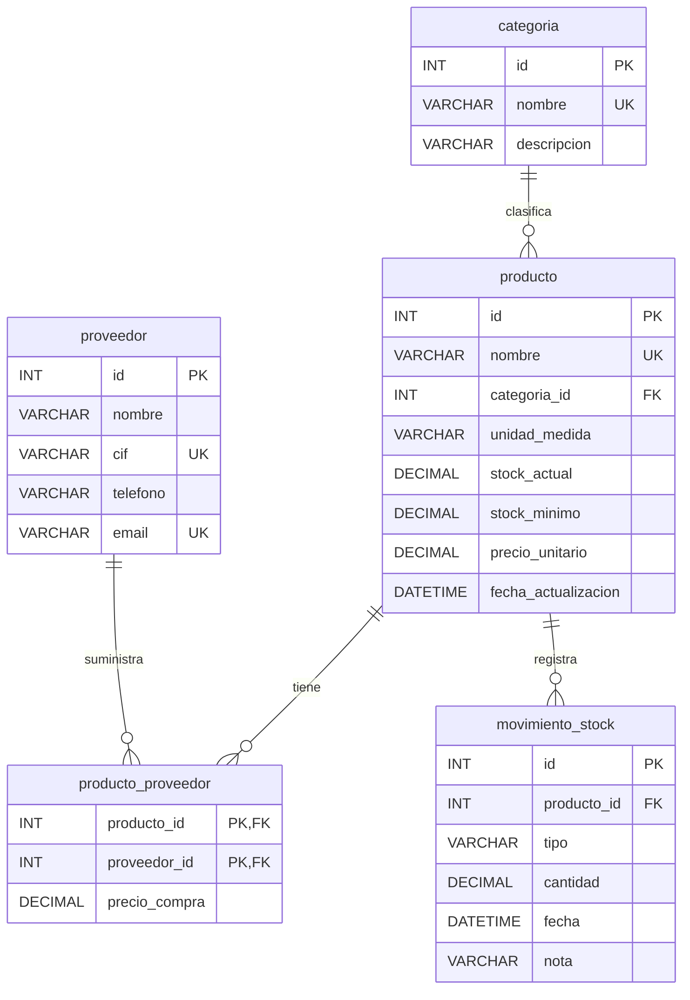
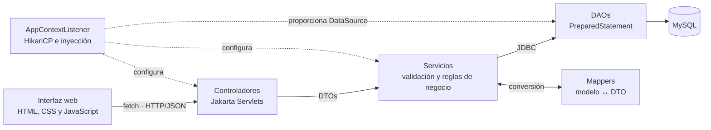
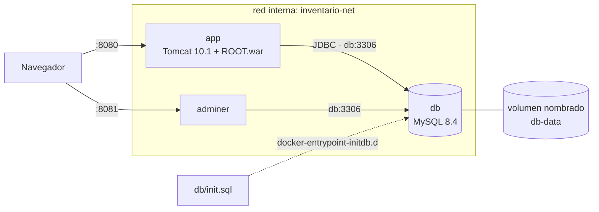
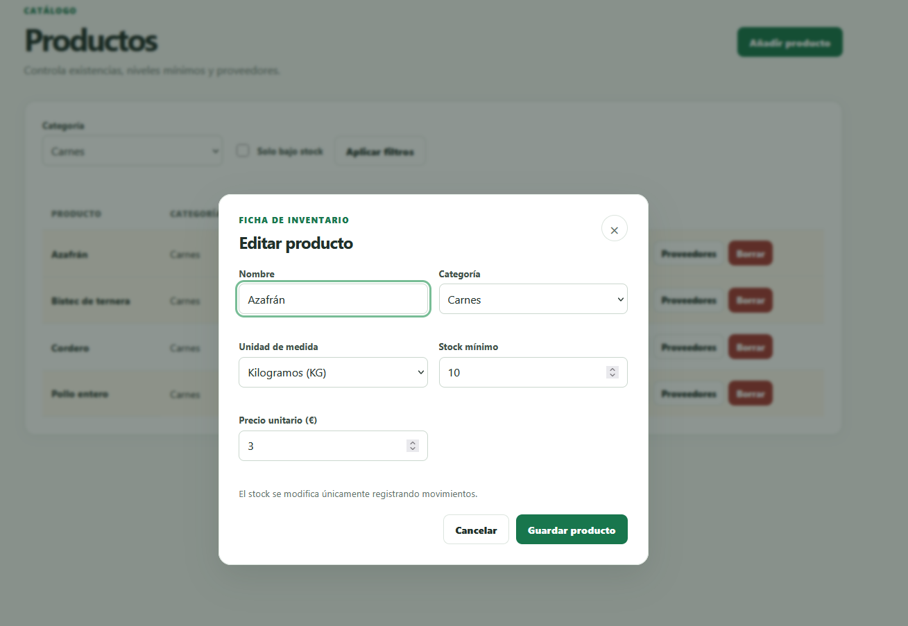
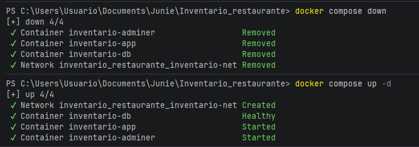
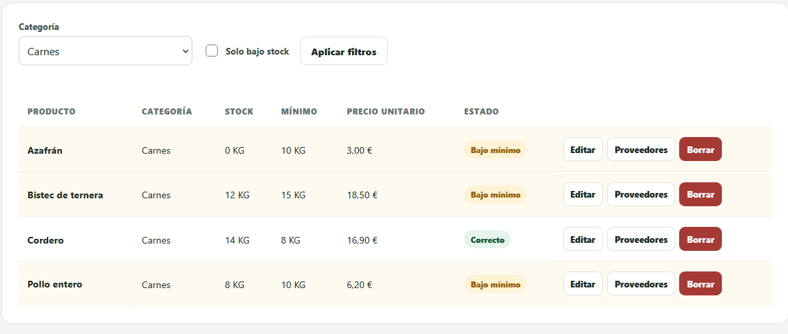

# Gestor de Inventario de Restaurante

Aplicación web para administrar productos, categorías, proveedores y movimientos de stock de un restaurante. Incluye un panel con el valor del inventario y alertas de productos por debajo del mínimo configurado.

## Stack tecnológico

- Java 21 y Maven; empaquetado WAR como `ROOT.war` para desplegar la aplicación en la raíz de Tomcat 10.1.
- Jakarta Servlet 6.0 para la API REST, JDBC con `PreparedStatement` y HikariCP para el acceso a MySQL.
- Jackson para JSON; HTML5, CSS3 y JavaScript moderno con `fetch` para la interfaz, sin frameworks.
- JUnit 5, Mockito y H2 en modo MySQL para las pruebas.

## Modelo de datos

El esquema consta de cinco tablas. Una categoría clasifica cero o más productos y cada producto pertenece a una categoría. Productos y proveedores se relacionan de muchos a muchos mediante `producto_proveedor`, que guarda el precio de compra. Cada producto puede tener múltiples movimientos de stock.



## Arquitectura

La aplicación separa la interfaz web de la API y aplica las capas Controlador → Servicio → DAO → Base de datos. Los servlets intercambian DTOs JSON con el cliente; los servicios aplican validaciones y reglas de negocio, y los DAOs ejecutan consultas JDBC parametrizadas.



## API REST

Las respuestas de error usan JSON y códigos semánticos: `400` para validación, `404` para recursos inexistentes, `409` para conflictos y `500` para errores internos. Las rutas se muestran relativas al contexto de la aplicación.

| Método | Endpoint | Descripción | Respuesta de éxito |
|---|---|---|---|
| `GET` | `/api/categorias` | Lista categorías. | `200` |
| `GET` | `/api/categorias/{id}` | Obtiene una categoría. | `200` |
| `POST` | `/api/categorias` | Crea una categoría. | `201` |
| `PUT` | `/api/categorias/{id}` | Actualiza una categoría. | `200` |
| `DELETE` | `/api/categorias/{id}` | Elimina una categoría. | `204` |
| `GET` | `/api/proveedores` | Lista proveedores. | `200` |
| `GET` | `/api/proveedores/{id}` | Obtiene un proveedor. | `200` |
| `POST` | `/api/proveedores` | Crea un proveedor. | `201` |
| `PUT` | `/api/proveedores/{id}` | Actualiza un proveedor. | `200` |
| `DELETE` | `/api/proveedores/{id}` | Elimina un proveedor. | `204` |
| `GET` | `/api/productos` | Lista productos; acepta `categoriaId` y `bajoStock=true` como filtros opcionales. | `200` |
| `GET` | `/api/productos/{id}` | Obtiene un producto. | `200` |
| `POST` | `/api/productos` | Crea un producto. | `201` |
| `PUT` | `/api/productos/{id}` | Actualiza los datos del producto. | `200` |
| `DELETE` | `/api/productos/{id}` | Elimina un producto. | `204` |
| `GET` | `/api/productos/{id}/proveedores` | Lista los proveedores asociados al producto. | `200` |
| `POST` | `/api/productos/{id}/proveedores` | Asocia un proveedor y su precio de compra. | `201` |
| `DELETE` | `/api/productos/{id}/proveedores/{proveedorId}` | Quita la asociación con un proveedor. | `204` |
| `GET` | `/api/movimientos` | Lista movimientos; acepta `productoId` como filtro opcional. | `200` |
| `POST` | `/api/movimientos` | Registra un movimiento de stock. | `201` |
| `GET` | `/api/dashboard` | Devuelve los totales, el valor del inventario y las alertas de stock bajo. | `200` |

## Movimientos de stock

Los movimientos forman parte del histórico de inventario y no se pueden editar ni borrar. Para corregir un registro, debe añadirse un movimiento nuevo que refleje el ajuste.

## Variables de entorno

La aplicación lee la configuración de conexión desde el entorno; no se deben guardar credenciales reales en el código ni en el repositorio.

| Variable | Uso |
|---|---|
| `DB_HOST` | Host o nombre DNS del servidor MySQL accesible desde Tomcat. |
| `DB_PORT` | Puerto de MySQL; normalmente `3306`. |
| `DB_NAME` | Nombre de la base de datos a la que se conecta la aplicación. |
| `DB_USER` | Usuario MySQL de la aplicación. |
| `DB_PASSWORD` | Contraseña de ese usuario. |
| `DB_ROOT_PASSWORD` | Contraseña administrativa que puede utilizar la configuración del contenedor MySQL; la aplicación Java no la lee. |

Las cinco primeras variables son obligatorias al iniciar la aplicación. `DB_ROOT_PASSWORD` solo la usa el contenedor de MySQL (para su usuario `root` y para el healthcheck) y no sustituye las credenciales de la aplicación.

Además, `docker-compose.yml` lee otras dos variables del `.env`: `APP_PORT` (puerto de la aplicación en tu equipo, por defecto `8080`) y `ADMINER_PORT` (puerto de Adminer, por defecto `8081`).

> Dentro de Docker, `DB_HOST` debe valer `db`, que es el nombre del servicio MySQL en la red interna. No uses `localhost`.

## Ejecutar las pruebas

Con Java 21 y Maven instalados, desde la raíz del proyecto ejecuta:

```text
mvn test
```

Las pruebas usan H2 y Mockito y no necesitan conectarse a una instancia MySQL.

## Despliegue con Docker

Todo el entorno se levanta con Docker Compose, con tres contenedores conectados por una red interna.

| Servicio | Imagen | Función | Puerto en tu equipo |
|---|---|---|---|
| `app` | Construida con el `Dockerfile` del proyecto | Tomcat 10.1 con `ROOT.war` | `8080` (`APP_PORT`) |
| `db` | `mysql:8.4` | Base de datos; ejecuta `db/init.sql` al crearse | No se expone |
| `adminer` | `adminer` | Interfaz web para ver los datos | `8081` (`ADMINER_PORT`) |



La base de datos no publica ningún puerto: solo `app` y `adminer` pueden alcanzarla a través de `inventario-net`.

### Cómo está montado

- **`Dockerfile` multi-stage.** La primera etapa (`maven:3.9-eclipse-temurin-21`) compila el proyecto y genera `target/ROOT.war`. La segunda (`tomcat:10.1-jdk21-temurin`) borra las aplicaciones de ejemplo y copia solo el WAR, así la imagen final no incluye Maven ni el código fuente. Los tests no se ejecutan al construir la imagen (`-DskipTests`); se ejecutan con `mvn test`.
- **Healthcheck y orden de arranque.** `db` tiene un healthcheck con `mysqladmin ping` contra `127.0.0.1`. `app` y `adminer` usan `depends_on` con `condition: service_healthy`, por lo que no arrancan hasta que MySQL está listo y ha terminado de ejecutar `init.sql`.
- **Inicialización automática.** `db/init.sql` se monta en `/docker-entrypoint-initdb.d/` y crea las tablas y los datos de prueba la primera vez que arranca el contenedor.
- **Persistencia.** Los datos de MySQL se guardan en el volumen nombrado `db-data`, que sobrevive a `docker compose down`.
- **Configuración externalizada.** Ninguna credencial está en el código ni en el `docker-compose.yml`: todo viene del archivo `.env`.

### Puesta en marcha paso a paso

Requisitos: Docker Desktop (o Docker Engine con el plugin Compose v2) en funcionamiento.

1. Clona el repositorio y entra en la carpeta del proyecto.
2. Crea tu `.env` a partir de la plantilla:

   ```text
   # Windows (PowerShell)
   Copy-Item .env.example .env

   # Linux, macOS o Git Bash
   cp .env.example .env
   ```

3. Abre `.env` y cambia **al menos** `DB_PASSWORD` y `DB_ROOT_PASSWORD`. Usa solo letras, números y guion bajo; evita `$`, `#`, comillas y espacios. Deja `DB_HOST=db`.
4. (Opcional) Comprueba que el `docker-compose.yml` es válido con tus variables:

   ```text
   docker compose config
   ```

5. Construye y levanta todo en segundo plano:

   ```text
   docker compose up --build -d
   ```

   La primera vez tarda varios minutos porque descarga las imágenes y las dependencias de Maven.
6. Comprueba el estado. `inventario-db` debe aparecer como `healthy`:

   ```text
   docker compose ps
   docker compose logs app
   ```

7. Abre la aplicación en el navegador.

### Puertos y accesos

| Qué | URL |
|---|---|
| Aplicación | <http://localhost:8080> |
| API (ejemplo) | <http://localhost:8080/api/productos> |
| Adminer | <http://localhost:8081> |

**Credenciales de prueba.** Los valores de ejemplo de `.env.example` son estos; sustituye las contraseñas por las que hayas puesto en tu `.env`:

| Dato | Valor |
|---|---|
| Sistema (Adminer) | `MySQL` |
| Servidor (Adminer) | `db` |
| Usuario de la aplicación | `inventario_user` |
| Contraseña de la aplicación | la de `DB_PASSWORD` en tu `.env` |
| Usuario administrador | `root` |
| Contraseña de `root` | la de `DB_ROOT_PASSWORD` en tu `.env` |
| Base de datos | `inventario` |

La aplicación no tiene inicio de sesión: se accede directamente desde el navegador.

### Persistencia de los datos

1. Crea o modifica un dato en la aplicación (por ejemplo, un producto nuevo).
2. Detén y elimina los contenedores **sin** borrar volúmenes:

   ```text
   docker compose down
   ```

3. Vuelve a levantar el entorno:

   ```text
   docker compose up -d
   ```

4. El dato sigue ahí, porque vive en el volumen `db-data` y no en el contenedor. Puedes ver el volumen con `docker volume ls`.

Prueba realizada con un producto creado desde la aplicación ("Azafrán"):

1. Antes de parar el entorno, el producto existe:

   

2. Se ejecuta `docker compose down` y después `docker compose up -d`. Los tres contenedores se eliminan y se vuelven a crear, y `inventario-db` aparece como `Healthy`:

   

3. Tras volver a levantar el entorno, el producto sigue en el listado:

   

> **Importante.** `init.sql` solo se ejecuta cuando el volumen está vacío. Si lo modificas, o cambias las contraseñas del `.env` después del primer arranque, debes borrar el volumen para que se vuelva a aplicar. **Esto elimina todos los datos:**
>
> ```text
> docker compose down -v
> docker compose up --build -d
> ```

### Comandos útiles

| Comando | Para qué sirve |
|---|---|
| `docker compose up --build -d app` | Reconstruir y reiniciar solo la aplicación tras cambiar el código |
| `docker compose logs -f app` | Ver los logs de la aplicación en directo (`Ctrl+C` para salir) |
| `docker compose logs db` | Ver los logs de MySQL |
| `docker compose down` | Parar y eliminar los contenedores, conservando los datos |
| `docker compose down -v` | Parar y eliminar contenedores **y datos** |

### Problemas frecuentes

| Síntoma | Causa y solución |
|---|---|
| `port is already allocated` | El puerto ya está en uso. Cambia `APP_PORT` o `ADMINER_PORT` en `.env`. |
| La app no conecta con la base de datos | Comprueba que `DB_HOST=db` en `.env` y que `inventario-db` está `healthy` en `docker compose ps`. |
| `Access denied for user` | Cambiaste las contraseñas después del primer arranque. Ejecuta `docker compose down -v` y levanta de nuevo. |
| Error de YAML en `docker compose config` | Indentación incorrecta: `volumes:` y `networks:` del final deben empezar en la primera columna. |
| `db` nunca llega a `healthy` | Revisa `docker compose logs db`; suele ser un error de sintaxis en `db/init.sql`. |

## Manual de uso de la aplicación

La barra de navegación superior da acceso a cinco pantallas:

- **Panel** (`index.html`): totales de productos, categorías y proveedores, valor del inventario y tabla de alertas con los productos cuyo stock está por debajo del mínimo.
- **Productos**: listado con filtro por categoría y opción de ver solo los productos con stock bajo. Permite crear, editar y borrar productos y gestionar los proveedores de cada uno con su precio de compra. El stock no se edita a mano: cambia solo mediante movimientos.
- **Categorías** y **Proveedores**: altas, ediciones y bajas. Una categoría con productos no se puede borrar.
- **Movimientos**: registra entradas, salidas y mermas de un producto y consulta el histórico, que se puede filtrar por producto. Una salida o merma mayor que el stock disponible se rechaza.

Los errores de validación aparecen junto al campo afectado, y los conflictos o errores del servidor se muestran como avisos.
