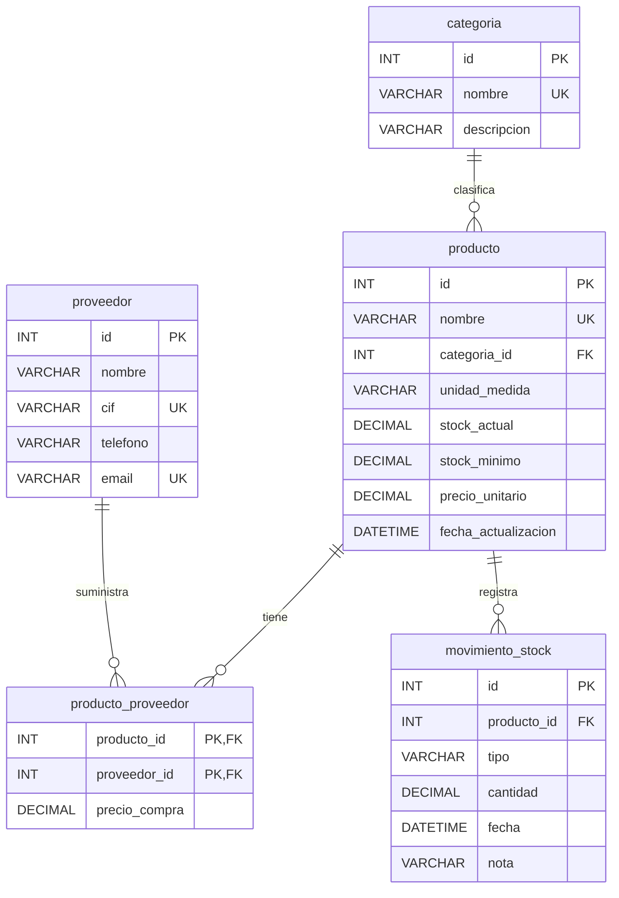
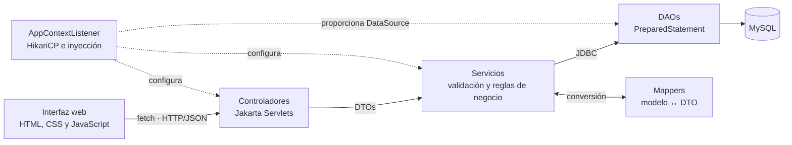

# Gestor de Inventario de Restaurante

Aplicación web para administrar productos, categorías, proveedores y movimientos de stock de un restaurante. Incluye un panel con el valor del inventario y alertas de productos por debajo del mínimo configurado.

## Stack tecnológico

- Java 21 y Maven; empaquetado WAR como `ROOT.war` para desplegar la aplicación en la raíz de Tomcat 10.1.
- Jakarta Servlet 6.0 para la API REST, JDBC con `PreparedStatement` y HikariCP para el acceso a MySQL.
- Jackson para JSON; HTML5, CSS3 y JavaScript moderno con `fetch` para la interfaz, sin frameworks.
- JUnit 5, Mockito y H2 en modo MySQL para las pruebas.

## Modelo de datos

El esquema consta de cinco tablas. Una categoría clasifica cero o más productos y cada producto pertenece a una categoría. Productos y proveedores se relacionan de muchos a muchos mediante `producto_proveedor`, que guarda el precio de compra. Cada producto puede tener múltiples movimientos de stock.



## Arquitectura

La aplicación separa la interfaz web de la API y aplica las capas Controlador → Servicio → DAO → Base de datos. Los servlets intercambian DTOs JSON con el cliente; los servicios aplican validaciones y reglas de negocio, y los DAOs ejecutan consultas JDBC parametrizadas.



## API REST

Las respuestas de error usan JSON y códigos semánticos: `400` para validación, `404` para recursos inexistentes, `409` para conflictos y `500` para errores internos. Las rutas se muestran relativas al contexto de la aplicación.

| Método | Endpoint | Descripción | Respuesta de éxito |
|---|---|---|---|
| `GET` | `/api/categorias` | Lista categorías. | `200` |
| `GET` | `/api/categorias/{id}` | Obtiene una categoría. | `200` |
| `POST` | `/api/categorias` | Crea una categoría. | `201` |
| `PUT` | `/api/categorias/{id}` | Actualiza una categoría. | `200` |
| `DELETE` | `/api/categorias/{id}` | Elimina una categoría. | `204` |
| `GET` | `/api/proveedores` | Lista proveedores. | `200` |
| `GET` | `/api/proveedores/{id}` | Obtiene un proveedor. | `200` |
| `POST` | `/api/proveedores` | Crea un proveedor. | `201` |
| `PUT` | `/api/proveedores/{id}` | Actualiza un proveedor. | `200` |
| `DELETE` | `/api/proveedores/{id}` | Elimina un proveedor. | `204` |
| `GET` | `/api/productos` | Lista productos; acepta `categoriaId` y `bajoStock=true` como filtros opcionales. | `200` |
| `GET` | `/api/productos/{id}` | Obtiene un producto. | `200` |
| `POST` | `/api/productos` | Crea un producto. | `201` |
| `PUT` | `/api/productos/{id}` | Actualiza los datos del producto. | `200` |
| `DELETE` | `/api/productos/{id}` | Elimina un producto. | `204` |
| `GET` | `/api/productos/{id}/proveedores` | Lista los proveedores asociados al producto. | `200` |
| `POST` | `/api/productos/{id}/proveedores` | Asocia un proveedor y su precio de compra. | `201` |
| `DELETE` | `/api/productos/{id}/proveedores/{proveedorId}` | Quita la asociación con un proveedor. | `204` |
| `GET` | `/api/movimientos` | Lista movimientos; acepta `productoId` como filtro opcional. | `200` |
| `POST` | `/api/movimientos` | Registra un movimiento de stock. | `201` |
| `GET` | `/api/dashboard` | Devuelve los totales, el valor del inventario y las alertas de stock bajo. | `200` |

## Movimientos de stock

Los movimientos forman parte del histórico de inventario y no se pueden editar ni borrar. Para corregir un registro, debe añadirse un movimiento nuevo que refleje el ajuste.

## Variables de entorno

La aplicación lee la configuración de conexión desde el entorno; no se deben guardar credenciales reales en el código ni en el repositorio.

| Variable | Uso |
|---|---|
| `DB_HOST` | Host o nombre DNS del servidor MySQL accesible desde Tomcat. |
| `DB_PORT` | Puerto de MySQL; normalmente `3306`. |
| `DB_NAME` | Nombre de la base de datos a la que se conecta la aplicación. |
| `DB_USER` | Usuario MySQL de la aplicación. |
| `DB_PASSWORD` | Contraseña de ese usuario. |
| `DB_ROOT_PASSWORD` | Contraseña administrativa que puede utilizar la configuración del contenedor MySQL; la aplicación Java no la lee. |

Las cinco primeras variables son obligatorias al iniciar la aplicación. `DB_ROOT_PASSWORD` queda documentada para el futuro despliegue y no sustituye las credenciales de la aplicación.

## Ejecutar las pruebas

Con Java 21 y Maven instalados, desde la raíz del proyecto ejecuta:

```text
mvn test
```

Las pruebas usan H2 y Mockito y no necesitan conectarse a una instancia MySQL.

## Despliegue con Docker

TODO (alumno): documentar la creación y configuración de los contenedores de la aplicación y MySQL, el despliegue de `ROOT.war` y las variables necesarias.

TODO (alumno): añadir aquí el diagrama Mermaid de contenedores y explicar sus conexiones y volúmenes.